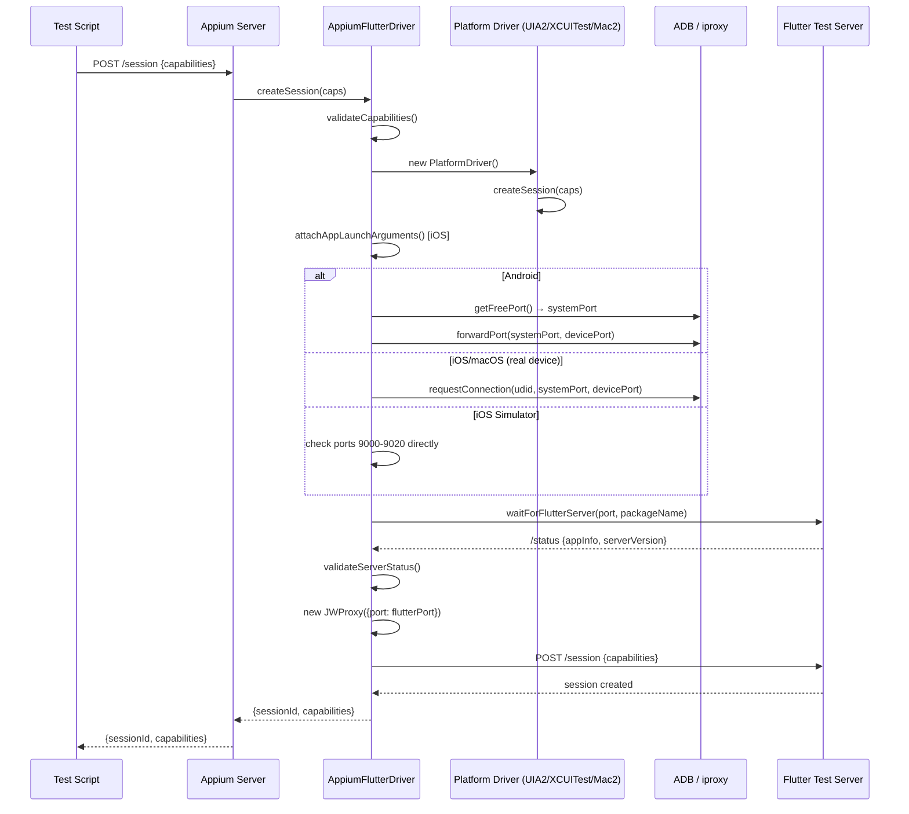
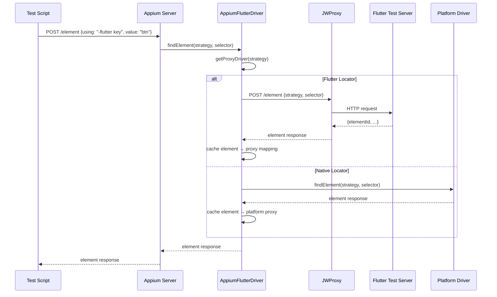
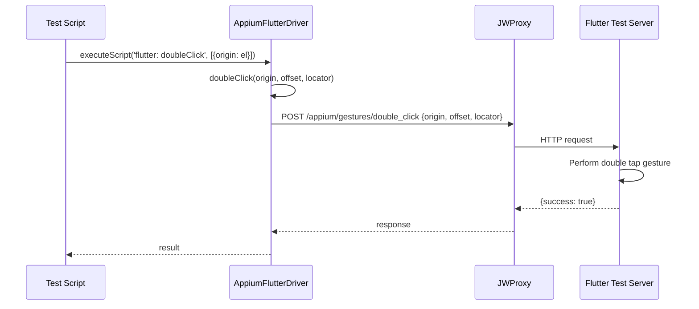
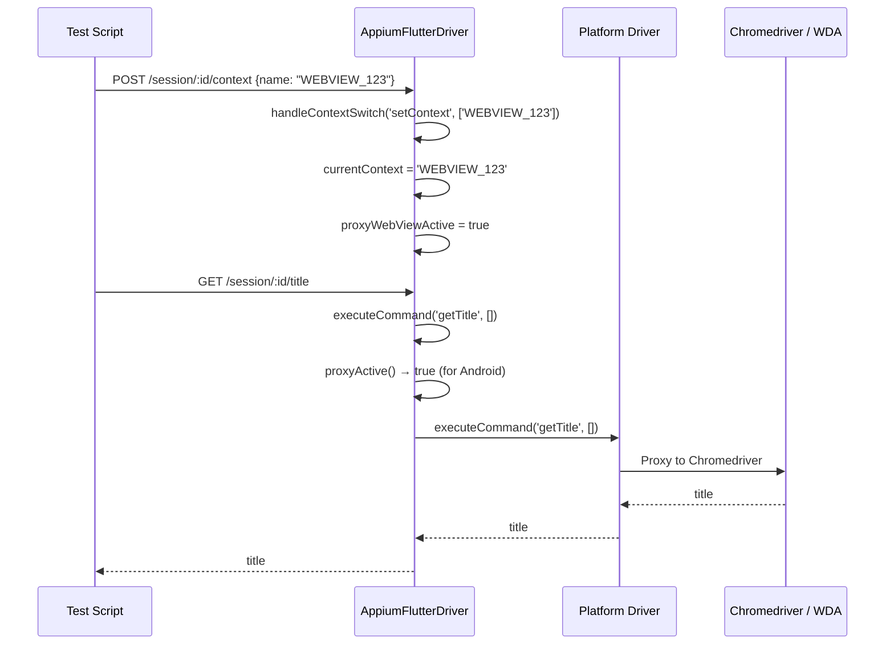

# Architecture Overview

Technical deep-dive into the Appium Flutter Integration Driver architecture.

---

## Table of Contents

- [High-Level Architecture](#high-level-architecture)
- [Component Diagram](#component-diagram)
- [Sequence Diagrams](#sequence-diagrams)
- [Data Flow](#data-flow)
- [Core Modules](#core-modules)
- [Port Forwarding Architecture](#port-forwarding-architecture)
- [Context Management](#context-management)
- [Element Resolution](#element-resolution)
- [System Requirements](#system-requirements)
- [Performance Considerations](#performance-considerations)
- [Security Model](#security-model)
- [Extension Points](#extension-points)

---

## High-Level Architecture

```
┌─────────────────────────────────────────────────────────────────────────────┐
│                              TEST RUNNER (WDIO)                              │
│  ┌─────────────────────────────────────────────────────────────────────┐    │
│  │  Test Script                                                        │    │
│  │  ├── browser.flutterByValueKey$('key')                              │    │
│  │  ├── browser.flutterScrollTillVisible({...})                        │    │
│  │  └── browser.executeScript('flutter: command', [params])            │    │
│  └─────────────────────────────────────────────────────────────────────┘    │
└──────────────────────────────────┬──────────────────────────────────────────┘
                                   │ WebDriver Protocol (HTTP/JSON)
                                   ▼
┌─────────────────────────────────────────────────────────────────────────────┐
│                        APPIUM SERVER (v3.x)                                  │
│  ┌─────────────────────────────────────────────────────────────────────┐    │
│  │  AppiumFlutterDriver (extends BaseDriver)                           │    │
│  │  ├── Session Management                                             │    │
│  │  ├── Command Routing (Flutter vs Native)                            │    │
│  │  ├── Proxy Management (JWProxy → Flutter Server)                   │    │
│  │  ├── Platform Driver Lifecycle (UIA2 / XCUITest / Mac2)            │    │
│  │  └── Port Forwarding Coordination                                   │    │
│  └─────────────────────────────────────────────────────────────────────┘    │
└──────────────────────────────────┬──────────────────────────────────────────┘
                                   │
               ┌───────────────────┼───────────────────┐
               ▼                   ▼                   ▼
┌─────────────────────────┐ ┌─────────────────────────┐ ┌─────────────────────────┐
│   Android Device        │ │   iOS Device            │ │   macOS Device          │
│   ┌─────────────────┐   │ │   ┌─────────────────┐   │ │   ┌─────────────────┐   │
│   │ UIAutomator2    │   │ │   │ XCUITest        │   │ │   │ Mac2            │   │
│   │ Driver          │   │ │   │ Driver          │   │ │   │ Driver          │   │
│   └────────┬────────┘   │ │   └────────┬────────┘   │ │   └────────┬────────┘   │
│            │            │ │            │            │ │            │            │
│            ▼            │ │            ▼            │ │            ▼            │
│   ┌─────────────────┐   │ │   ┌─────────────────┐   │ │   ┌─────────────────┐   │
│   │ ADB Port        │   │ │   │ iproxy          │   │ │   │ iproxy          │   │
│   │ Forwarding      │   │ │   │ Port Forwarding │   │ │   │ Port Forwarding │   │
│   └────────┬────────┘   │ │   └────────┬────────┘   │ │   └────────┬────────┘   │
└─────────────│────────────┘ └─────────────│────────────┘ └─────────────│────────────┘
              │                            │                            │
              ▼                            ▼                            ▼
┌─────────────────────────────────────────────────────────────────────────────┐
│                    FLUTTER INTEGRATION TEST SERVER                           │
│  (Embedded in App Under Test via integration_test package)                  │
│  ┌─────────────────────────────────────────────────────────────────────┐    │
│  │  HTTP Server (ports 9000-9020 on device)                            │    │
│  │  ├── Element Finding (by Key, Semantics, Text, Type, etc.)         │    │
│  │  ├── Gestures (Tap, Double Tap, Long Press, Drag, Scroll)          │    │
│  │  ├── Text Input / Clear / Get Text / Get Attributes                │    │
│  │  ├── Render Tree Inspection                                         │    │
│  │  ├── Image Injection / Activation                                   │    │
│  │  └── App Launch / Wait Commands                                     │    │
│  └─────────────────────────────────────────────────────────────────────┘    │
└─────────────────────────────────────────────────────────────────────────────┘
```

---

## Component Diagram

```
┌────────────────────────────────────────────────────────────────────────────┐
│                           APPIUM FLUTTER DRIVER                              │
│  ┌──────────────────────────────────────────────────────────────────────┐  │
│  │                        AppiumFlutterDriver                            │  │
│  │  ┌──────────────┐ ┌──────────────┐ ┌──────────────┐ ┌────────────┐  │  │
│  │  │ Session Mgmt │ │Command Router│ │ Proxy Manager│ │Port Manager│  │  │
│  │  └──────────────┘ └──────────────┘ └──────────────┘ └────────────┘  │  │
│  │        │                │                │                │          │  │
│  │  ┌─────▼────────────────▼────────────────▼────────────────▼─────┐   │  │
│  │  │              Platform Driver Factory                          │   │  │
│  │  │  ┌─────────────┐  ┌─────────────┐  ┌─────────────────────┐  │   │  │
│  │  │  │   Android   │  │     iOS     │  │        Mac          │  │   │  │
│  │  │  │ (UIA2 Driver)│  │(XCUITest    │  │      (Mac2 Driver) │  │   │  │
│  │  │  │             │  │  Driver)    │  │                     │  │   │  │
│  │  │  └─────────────┘  └─────────────┘  └─────────────────────┘  │   │  │
│  │  └──────────────────────────────────────────────────────────────┘   │  │
│  └──────────────────────────────────────────────────────────────────────┘  │
└────────────────────────────────────────────────────────────────────────────┘
```

### Core Classes

| Class | File | Responsibility |
|-------|------|----------------|
| `AppiumFlutterDriver` | `src/driver.ts` | Main driver, command routing, proxy management |
| `createSession` | `src/session.ts` | Platform-specific session creation |
| `Element Commands` | `src/commands/element.ts` | Element interaction implementations |
| `Utils` | `src/utils.ts` | Port discovery, server validation, locator strategies |
| `Platform Modules` | `src/android.ts`, `iOS.ts`, `macOS.ts` | Platform driver lifecycle |
| `iProxy` | `src/iProxy.ts` | iOS/macOS port forwarding via iproxy |

---

## Sequence Diagrams

### Session Creation



### Flutter Command Execution



### Gesture Command (Double Click)



### WebView Context Switch



---

## Data Flow

### Element Resolution Flow

```
┌─────────────┐     ┌─────────────┐     ┌──────────────────┐     ┌─────────────┐
│   Locator   │────▶│   Strategy  │────▶│  Proxy Selection │────▶│   Target    │
│  (Strategy, │     │  Analysis   │     │                  │     │   Server    │
│   Selector) │     │             │     │  Flutter: JWProxy │     │             │
└─────────────┘     └─────────────┘     │  Native: Platform │     └──────┬──────┘
                                         │     Proxy         │            │
                                         └────────┬──────────┘            │
                                                  │                       │
                                                  ▼                       ▼
                                         ┌─────────────────┐     ┌─────────────────┐
                                         │ ELEMENT_CACHE   │     │  Response       │
                                         │ Map<id, proxy>  │     │  {ELEMENT: id}  │
                                         └────────┬────────┘     └────────┬────────┘
                                                  │                       │
                                                  └───────────┬───────────┘
                                                              ▼
                                                 ┌─────────────────────┐
                                                 │ Subsequent Commands │
                                                 │ use cached proxy    │
                                                 └─────────────────────┘
```

### Port Forwarding Flow

```
Android:                          iOS Real Device:                   iOS Simulator:
┌──────────────┐                 ┌──────────────┐                   ┌──────────────┐
│  System Port │                 │  System Port │                   │  Device Port │
│  (10000-     │                 │  (10000-     │                   │  (9000-9020) │
│   11000)     │                 │   11000)     │                   └──────┬───────┘
└──────┬───────┘                 └──────┬───────┘                          │
       │                                │                                  │
       ▼                                ▼                                  ▼
┌──────────────┐                 ┌──────────────┐                   ┌──────────────┐
│   ADB        │                 │   iproxy     │                   │   Direct     │
│  forward     │                 │  (libimobile │                   │   Connection │
│  tcp:sysPort │                 │   device)    │                   │   (localhost)│
│  tcp:devPort │                 └──────┬───────┘                   └──────────────┘
└──────┬───────┘                        │
       │                                │
       ▼                                ▼
┌─────────────────────────────────────────────────────────────┐
│              Flutter Test Server (Device Port 9000-9020)    │
└─────────────────────────────────────────────────────────────┘
```

---

## Core Modules

### 1. `AppiumFlutterDriver` (`src/driver.ts`)

**Key Responsibilities:**
- Extends `@appium/base-driver.BaseDriver`
- Manages platform driver lifecycle (`proxydriver`)
- Routes commands: Flutter vs Native
- Manages `JWProxy` connection to Flutter server
- Handles context switching (NATIVE_APP ↔ WEBVIEW)

**Key Methods:**
| Method | Purpose |
|--------|---------|
| `createSession()` | Full session initialization |
| `deleteSession()` | Cleanup ports, drivers |
| `executeCommand()` | Route command to Flutter or platform |
| `getProxyDriver()` | Select correct proxy for locator |
| `handleContextSwitch()` | Manage NATIVE/WEBVIEW contexts |
| `proxyActive()` | Determine if proxying to platform |
| `canProxy()` | WebDriverAgent proxy capability |

**Command Map (`executeMethodMap`):**
Maps `flutter:*` commands to handler methods with parameter validation.

---

### 2. Session Management (`src/session.ts`)

```typescript
export async function createSession(
  this: AppiumFlutterDriver,
  sessionId: string,
  caps: any,
  ...args: any[]
): Promise<DefaultCreateSessionResult>
```

**Platform Selection:**
```typescript
switch (platformName.toLowerCase()) {
  case 'ios':     return startIOSSession(...);
  case 'android': return startAndroidSession(...);
  case 'mac':     return startMacOsSession(...);
}
```

**Security Settings Propagation:**
```typescript
this.proxydriver.relaxedSecurityEnabled = this.relaxedSecurityEnabled;
this.proxydriver.denyInsecure = this.denyInsecure;
this.proxydriver.allowInsecure = this.allowInsecure;
```

---

### 3. Element Commands (`src/commands/element.ts`)

**Element Cache:**
```typescript
export const ELEMENT_CACHE = new Map();
// Maps elementId → proxy driver (JWProxy or platform proxy)
```

**Locator Construction:**
```typescript
function constructFindElementPayload(
  strategy: string,
  selector: string,
  context?: any,
  proxyDriver?: PlatformDriver
): FindElementPayload
```

Handles:
- Flutter locators → `{ strategy, selector, context }`
- Native iOS/macOS locators → `{ using, value, context }`
- Complex locators (descendant/ancestor) → JSON parsing

**Mac2Driver Special Handling:**
Non-blocking click for Flutter elements to avoid hangs when native dialogs open.

---

### 4. Utilities (`src/utils.ts`)

**Key Functions:**

| Function | Purpose |
|----------|---------|
| `getProxyDriver()` | Select proxy based on locator strategy |
| `isFlutterDriverCommand()` | Check if command should use Flutter server |
| `getFreePort()` | Find available system port (10000-11000) |
| `fetchFlutterServerPort()` | Discover Flutter server via port scanning |
| `waitForFlutterServerToBeActive()` | Poll `/status` until ready |
| `validateServerStatus()` | Verify package name & version compatibility |
| `attachAppLaunchArguments()` | Inject `--flutter-server-port` for iOS |
| `readManifest()` | Read package.json for version requirements |

**Port Ranges:**
```typescript
const DEVICE_PORT_RANGE = [9000, 9020];    // On device
const SYSTEM_PORT_RANGE = [10000, 11000];  // On host
```

**Flutter Locators:**
```typescript
export const FLUTTER_LOCATORS = [
  'key', 'semantics label', 'text', 'type', 
  'text containing', 'descendant', 'ancestor'
];
```

---

### 5. Platform Modules

#### Android (`src/android.ts`)
```typescript
export async function startAndroidSession(...): Promise<AndroidUiautomator2Driver>
export async function androidPortForward(adb, systemPort, devicePort)
export async function androidRemovePortForward(adb, systemPort)
```

Uses ADB `forward`/`forward --remove`.

#### iOS (`src/iOS.ts`)
```typescript
export async function startIOSSession(...): Promise<XCUITestDriver>
export async function iosPortForward(udid, systemPort, devicePort)
export function iosRemovePortForward(udid, systemPort)
```

Uses `DEVICE_CONNECTIONS_FACTORY` (iproxy manager).

#### macOS (`src/macOS.ts`)
Similar to iOS, uses Mac2Driver and iproxy.

---

### 6. iProxy / Device Connections Factory (`src/iProxy.ts`)

**`iProxy` Class:**
- TCP server on host `systemPort`
- Forwards to device `devicePort` via `libimobiledevice` `connectPort`
- Bidirectional pipe: `localSocket ↔ remoteSocket`
- Auto-cleanup on process exit

**`DeviceConnectionsFactory` Class:**
- Singleton managing multiple iproxy instances
- Key format: `udid:port`
- Port conflict detection & resolution
- Connection listing & release

---

## Port Forwarding Architecture

### Why Port Forwarding?

The Flutter test server runs **on the device** (ports 9000-9020). The Appium server runs **on the host**. They need to communicate.

### Android: ADB Forward

```
Host (Appium)                    Device
┌─────────────┐     ADB      ┌─────────────┐
│  JWProxy    │─────────────▶│  Flutter    │
│  :systemPort│  forward     │  Server     │
│             │  tcp:sysPort │  :devicePort│
└─────────────┘  tcp:devPort └─────────────┘
```

- `systemPort`: 10000-11000 (host)
- `devicePort`: 9000-9020 (device)
- Managed by `androidPortForward` / `androidRemovePortForward`

### iOS Real Device: iproxy

```
Host (Appium)                    Device
┌─────────────┐     USB      ┌─────────────┐
│  iproxy     │─────────────▶│  Flutter    │
│  :systemPort│  tunnel      │  Server     │
│             │              │  :devicePort│
└─────────────┘              └─────────────┘
```

- Uses `libimobiledevice` `connectPort` via `appium-ios-device`
- Managed by `DeviceConnectionsFactory` → `iProxy` instances
- Supports multiple concurrent devices

### iOS Simulator: Direct Connection

```
Host (Appium)                    Simulator
┌─────────────┐   localhost   ┌─────────────┐
│  JWProxy    │──────────────▶│  Flutter    │
│  :devicePort│  (same port)  │  Server     │
│             │               │  :devicePort│
└─────────────┘               └─────────────┘
```

- No port forwarding needed
- Simulator shares host network namespace
- Scans ports 9000-9020 directly

---

## Context Management

### Context Types

| Context | Description | Handler |
|---------|-------------|---------|
| `NATIVE_APP` | Flutter app UI | Flutter Server |
| `WEBVIEW_*` | Web content in app | Platform Driver (Chromedriver/WDA) |

### State Machine

```
                    ┌─────────────────┐
                    │   NATIVE_APP    │
                    │ (Flutter Proxy) │
                    └────────┬────────┘
                             │ setContext(WEBVIEW)
                             ▼
                    ┌─────────────────┐
                    │   WEBVIEW_*     │
                    │ (Platform Proxy)│
                    └────────┬────────┘
                             │ setContext(NATIVE_APP)
                             ▼
                    ┌─────────────────┐
                    │   NATIVE_APP    │
                    └─────────────────┘
```

### Implementation (`driver.ts`)

```typescript
private handleContextSwitch(command: string, args: any[]): void {
  if (command === 'setContext') {
    const isWebviewContext = args[0]?.includes('WEBVIEW');
    this.currentContext = args[0];
    this.proxyWebViewActive = isWebviewContext;
  }
}

public proxyActive(): boolean {
  return this.proxyWebViewActive && 
         !(this.proxydriver instanceof XCUITestDriver);
}
```

**Key Insight:** On iOS, XCUITest driver handles WebView directly via WDA. On Android, UIA2 driver proxies to Chromedriver. The Flutter driver only proxies WebView on Android.

### WEBVIEW_NO_PROXY Routes

Certain routes bypass proxy even in WebView context:

```typescript
const WEBVIEW_NO_PROXY = [
  ['GET',  /^/session/[^/]+/appium/],
  ['GET',  /^/session/[^/]+/context/],
  ['GET',  /^/session/[^/]+/element/[^/]+/rect/],
  ['POST', /^/session/[^/]+/appium/],
  // ... more
];
```

---

## Element Resolution

### Locator Strategy Priority

```
1. -flutter key              → Flutter Server
2. -flutter semantics label  → Flutter Server
3. -flutter text             → Flutter Server
4. -flutter type             → Flutter Server
5. -flutter text containing  → Flutter Server
6. -flutter descendant       → Flutter Server
7. -flutter ancestor         → Flutter Server
8. key (legacy)              → Flutter Server
9. semantics label (legacy)  → Flutter Server
... (other legacy)
10. xpath                    → Platform Driver
11. css selector             → Platform Driver
12. id                       → Platform Driver
13. accessibility id         → Platform Driver
14. -android uiautomator     → Platform Driver (Android)
15. -ios predicate string    → Platform Driver (iOS)
16. -ios class chain         → Platform Driver (iOS)
```

### Element Cache

```typescript
// In element.ts
export const ELEMENT_CACHE = new Map<string, JWProxy>();

// On findElement:
ELEMENT_CACHE.set(element.ELEMENT || element[W3C_ELEMENT_KEY], driver);

// On click/getText/etc:
const driver = ELEMENT_CACHE.get(elementId);
return driver.command(...);
```

**Purpose:** Route subsequent commands on the same element to the correct backend (Flutter vs Platform).

### Complex Locators (Descendant/Ancestor)

```typescript
// Selector is JSON string:
{
  "of": { "using": "-flutter key", "value": "parent" },
  "matching": { "using": "-flutter text", "value": "Child" }
}
```

Parsed in `constructFindElementPayload`:
```typescript
if (['-flutter descendant', '-flutter ancestor'].includes(strategy)) {
  parsedSelector = JSON.parse(selector);
}
```

---

## System Requirements

### Host Machine

| Component | Minimum | Recommended |
|-----------|---------|-------------|
| Node.js | 18.x | 20.x LTS |
| RAM | 8 GB | 16+ GB |
| CPU | 2 cores | 4+ cores |
| Disk | 10 GB free | 50+ GB free |
| OS | macOS 12+, Ubuntu 20+, Windows 10+ | Latest LTS |

### Android

| Component | Version |
|-----------|---------|
| Android SDK | API 34 (Android 14) |
| Platform Tools | Latest |
| Build Tools | 34.0.0 |
| Emulator | 34.x |
| UIAutomator2 | Via Appium |

### iOS

| Component | Version |
|-----------|---------|
| Xcode | 15+ |
| iOS SDK | 17+ |
| WebDriverAgent | Via Appium |
| libimobiledevice | Latest |
| iproxy | Via libimobiledevice |

### macOS

| Component | Version |
|-----------|---------|
| macOS | 13+ (Ventura) |
| Xcode | 15+ |
| Mac2Driver | Via Appium |

### Flutter App

| Component | Version |
|-----------|---------|
| Flutter SDK | 3.16+ |
| integration_test | Latest |
| Flutter Test Server | >=0.0.18 <1.0.0 |

---

## Performance Considerations

### Port Scanning Overhead

- **Issue:** `fetchFlutterServerPort` scans up to 20 ports
- **Mitigation:** Use `flutterSystemPort` capability for fixed port
- **iOS Simulator:** No scanning needed (direct connection)

### Element Cache Efficiency

- **O(1)** lookup via Map
- **Memory:** ~1KB per cached element
- **Cleanup:** Automatic on `deleteSession`

### Command Routing Latency

| Path | Typical Latency |
|------|-----------------|
| Flutter → Flutter Server | 10-50ms |
| Native → Platform Driver | 20-100ms |
| WebView → Chromedriver | 50-200ms |

### Optimization Tips

1. **Use ValueKeys** - Fastest element location
2. **Reuse sessions** - Avoid `createSession` overhead
3. **Batch commands** - Minimize round trips
4. **Fixed ports** - Eliminate port scanning
5. **Parallel devices** - Not parallel sessions on same device

---

## Security Model

### Attack Surface

| Component | Risk | Mitigation |
|-----------|------|------------|
| Port Forwarding | Port hijacking | Random ports, short-lived |
| JWProxy | MITM | Localhost only, no TLS needed |
| iproxy | USB access | Requires physical/trusted device |
| Flutter Server | App compromise | Embedded in debug/profile builds only |

### Capabilities Validation

```typescript
const desiredCapConstraints = {
  platformName: { inclusionCaseInsensitive: ['iOS', 'Android', 'Mac'] },
  automationName: { presence: true },
  // ... strict validation
};
```

### Relaxed Security

Inherits from `@appium/base-driver`:
- `relaxedSecurityEnabled`
- `allowInsecure` / `denyInsecure`
- Propagated to platform drivers

---

## Extension Points

### Adding New Flutter Commands

1. **Add to `executeMethodMap`** (`driver.ts`):
```typescript
'flutter: myCommand': {
  command: 'myCommand',
  params: { required: ['param1'], optional: ['param2'] }
}
```

2. **Implement handler** (`driver.ts`):
```typescript
async myCommand(param1: string, param2?: number) {
  return this.proxy?.command('/my/endpoint', 'POST', { param1, param2 });
}
```

3. **Add WDIO wrapper** (`flutter-finder/wdio-flutter-by-service/src/methods.ts`):
```typescript
export async function flutterMyCommand(this: Browser, options) {
  return browser.executeScript('flutter: myCommand', [options]);
}
```

4. **Register in service** (`flutter-finder/wdio-flutter-by-service/src/service.ts`):
```typescript
registerCustomMethod('myCommand', methods.myCommand, { attachToBrowser: true });
```

### Adding New Locator Strategies

1. **Add to `FLUTTER_LOCATORS`** (`utils.ts`)
2. **Add to `locatorStrategies`** (`driver.ts` constructor)
3. **Add WDIO locator** (`flutter-finder/wdio-flutter-by-service/src/service.ts`)

### Custom Platform Support

1. **Create platform module** (`src/newPlatform.ts`)
2. **Add to `createSession` switch** (`session.ts`)
3. **Implement port forwarding** (if needed)
4. **Update `desiredCapConstraints`** (`desiredCaps.ts`)

---

## Maintenance Notes

### Version Compatibility Matrix

| Driver Version | Appium | Flutter Server | Node.js |
|----------------|--------|----------------|---------|
| 2.x | 3.x | >=0.0.18 <1.0.0 | 18+ |
| 1.x | 2.x | >=0.0.18 <1.0.0 | 16+ |

### Key Dependencies

```json
{
  "@appium/base-driver": "^10.0.0",
  "appium-uiautomator2-driver": "^5.0.0",
  "appium-xcuitest-driver": "^12.0.0",
  "appium-mac2-driver": "^3.0.0",
  "appium-adb": "^13.0.0",
  "appium-ios-device": "^3.0.0"
}
```

### Breaking Change Checklist

When updating dependencies:
- [ ] Test Android session creation
- [ ] Test iOS session creation (simulator & device)
- [ ] Test macOS session creation
- [ ] Test port forwarding (all platforms)
- [ ] Test WebView context switching
- [ ] Test all Flutter locator strategies
- [ ] Test all gesture commands
- [ ] Test image injection/activation
- [ ] Run full E2E test suite

---

*Architecture version: 2.0 | Last updated: 2025*